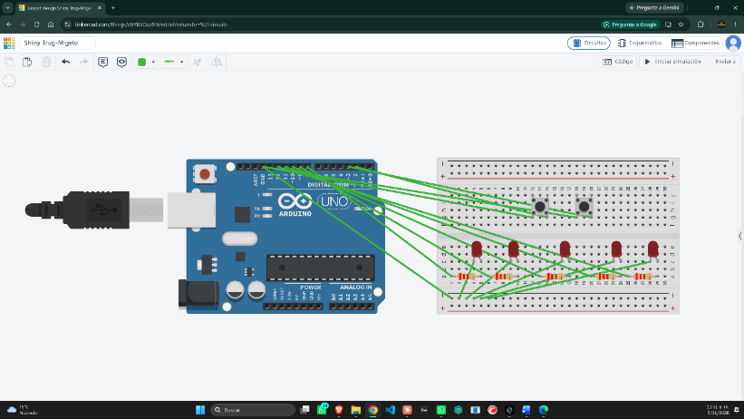
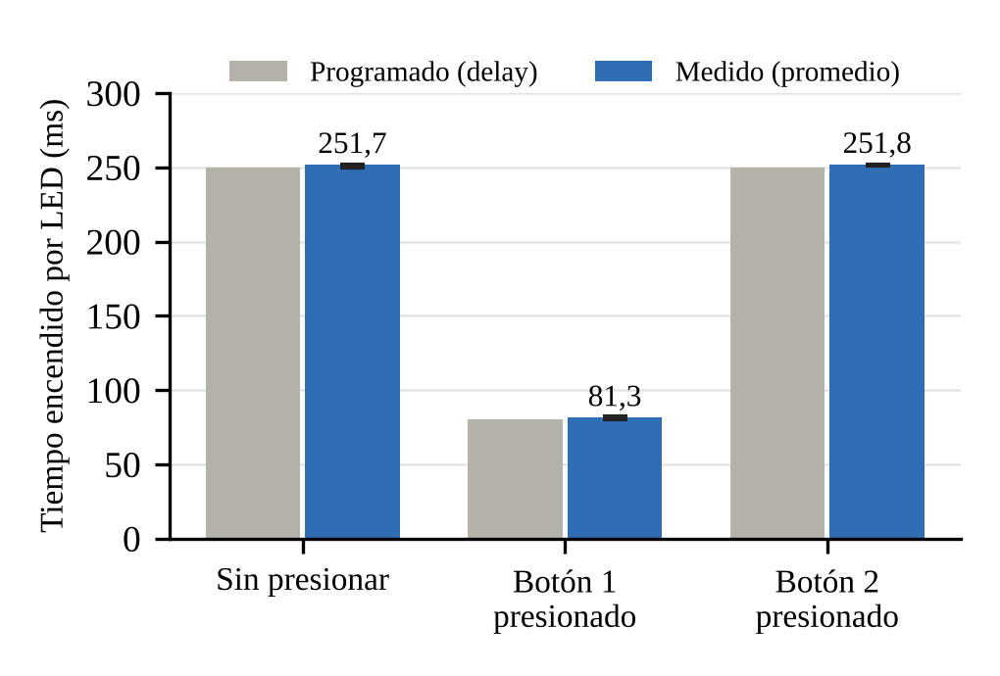

# Entrega 1 – Blink con cinco salidas y dos entradas

**Simulación en Tinkercad:** [Abrir en Tinkercad](https://www.tinkercad.com/things/cbYBSOzz8i9-entrega-internet-de-las-cosas?sharecode=Mycaf2Bx0_Yeii9l4UDihEZ-cH-o2BNq5Om33Pkl-3I)
**Artículo:** [`articulo/Internet_de_las_cosas_Entrega_1.pdf`](articulo/Internet_de_las_cosas_Entrega_1.pdf)

## Descripción

Cinco LED conectados a un Arduino UNO R3 se encienden uno tras otro (barrido). Dos pulsadores simulan sensores:

- **Pulsador 1 (pin 2):** acelera la secuencia (80 ms por LED en lugar de 250 ms).
- **Pulsador 2 (pin 3):** invierte el sentido de la secuencia (de 8 a 12 en lugar de 12 a 8).

Los pulsadores usan `INPUT_PULLUP`, por lo que no necesitan resistencias externas. En cada paso, el programa envía al Monitor Serie una línea CSV con el tiempo (`millis()`), el estado de los dos pulsadores y el pin del LED encendido.

## Conexiones

| Elemento | Pin Arduino | Función |
|---|---|---|
| LED 1 a LED 5 (con resistencia de 220 Ω a GND) | 12, 11, 10, 9, 8 | Salidas digitales |
| Pulsador 1 (a GND) | 2 | Entrada: acelera la secuencia |
| Pulsador 2 (a GND) | 3 | Entrada: invierte el sentido |

## Código

[`codigo/Blink_5salidas_2entradas/Blink_5salidas_2entradas.ino`](codigo/Blink_5salidas_2entradas/Blink_5salidas_2entradas.ino)

## Mediciones

| Archivo | Contenido |
|---|---|
| `datos/resumen_mediciones.csv` | Duración del LED encendido según el estado de los pulsadores (73 muestras, 72 intervalos). |
| `datos/recursos_sistema_operativo.csv` | CPU, RAM, GPU, Wi-Fi y procesos en tres escenarios (navegador cerrado, Tinkercad sin simular y simulación en ejecución). |
| `recursos-sistema-operativo/` | Capturas originales del Administrador de tareas de Windows 11 (9 de noviembre de 2026). |

**Resultados principales:** sin presionar, cada LED permaneció encendido 251,7 ms en promedio (250 ms programados); con el pulsador 1, 81,3 ms (80 ms programados); con el pulsador 2, 251,8 ms en sentido inverso.

