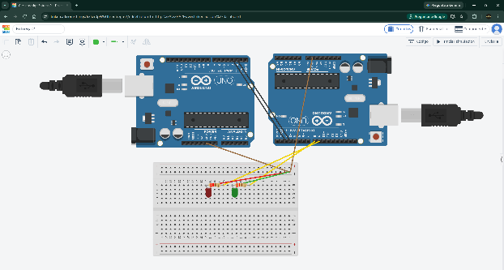
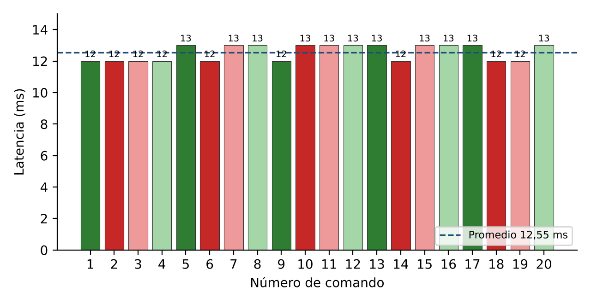

# Entrega 2 – Emulación de un enlace Bluetooth entre dos Arduino UNO

**Simulación en Tinkercad:** [Abrir en Tinkercad](https://www.tinkercad.com/things/635zr0pWGUh-entrega-2?sharecode=XhJBw0Ih7xSG-tpHKMKaIMD3OPxAG4WwV8C1qhgxH8E)
**Artículo:** [`articulo/Internet_de_las_cosas_Entrega_2.pdf`](articulo/Internet_de_las_cosas_Entrega_2.pdf)

## Descripción

La guía pide un circuito que reciba comandos por Bluetooth (módulo HC-05) y controle dos LED con un Arduino. Como Tinkercad Circuits no incluye módulos Bluetooth, y el HC-05 se comporta como un puente serial, el enlace se emuló con **SoftwareSerial** entre dos Arduino UNO:

- **Arduino 1 – emisor:** hace el papel del teléfono. Envía los comandos escritos en su Monitor Serie y mide la latencia de la confirmación.
- **Arduino 2 – receptor:** hace el papel de la placa con el módulo Bluetooth. Enciende o apaga los LED y responde con `K` (ACK).

| Comando | Acción |
|---|---|
| `1` | Enciende el LED verde |
| `0` | Apaga el LED verde |
| `2` | Enciende el LED rojo |
| `3` | Apaga el LED rojo |

El enlace trabaja a **4800 baudios**, porque a 9600 la confirmación llegaba alterada. El Monitor Serie trabaja a 9600 baudios.

## Conexiones

| Origen | Destino | Función |
|---|---|---|
| Arduino 1, pin 3 (TX) | Arduino 2, pin 2 (RX) | Envío de comandos |
| Arduino 1, pin 2 (RX) | Arduino 2, pin 3 (TX) | Confirmación (ACK) |
| Arduino 1, GND | Arduino 2, GND | Tierra común |
| Arduino 2, pin 8 | Resistencia 220 Ω → LED verde | Salida digital |
| Arduino 2, pin 9 | Resistencia 220 Ω → LED rojo | Salida digital |

## Código

- [`codigo/emisor/emisor.ino`](codigo/emisor/emisor.ino): Arduino 1
- [`codigo/receptor/receptor.ino`](codigo/receptor/receptor.ino): Arduino 2

## Mediciones

| Archivo | Contenido |
|---|---|
| `datos/emisor_monitor_serie.csv` | Registros del Monitor Serie del emisor: `n,tiempo_ms,comando,latencia_ms,respuesta` (20 comandos). |
| `datos/receptor_monitor_serie.csv` | Registros del Monitor Serie del receptor: `n,tiempo_ms,comando,accion` (20 comandos). |
| `datos/recursos_sistema_operativo.csv` | CPU, RAM, GPU, Wi-Fi y procesos en tres escenarios. |
| `recursos-sistema-operativo/` | Capturas originales del Administrador de tareas de Windows 11 (10 de noviembre de 2026). |

**Resultados principales:** los 20 comandos (secuencia 1, 2, 3, 0 repetida cinco veces) se ejecutaron y confirmaron correctamente (100 %), con una latencia promedio de 12,55 ms (mínimo 12 ms, máximo 13 ms).

